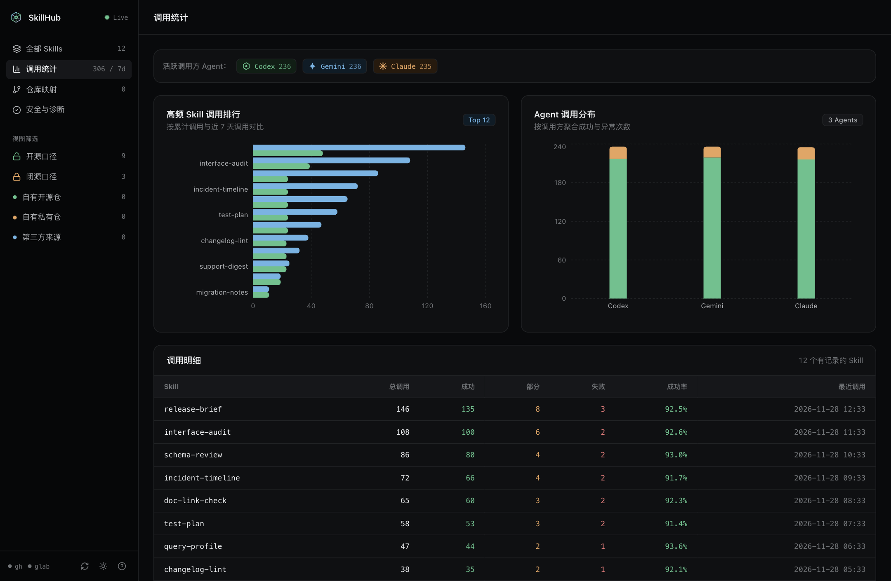
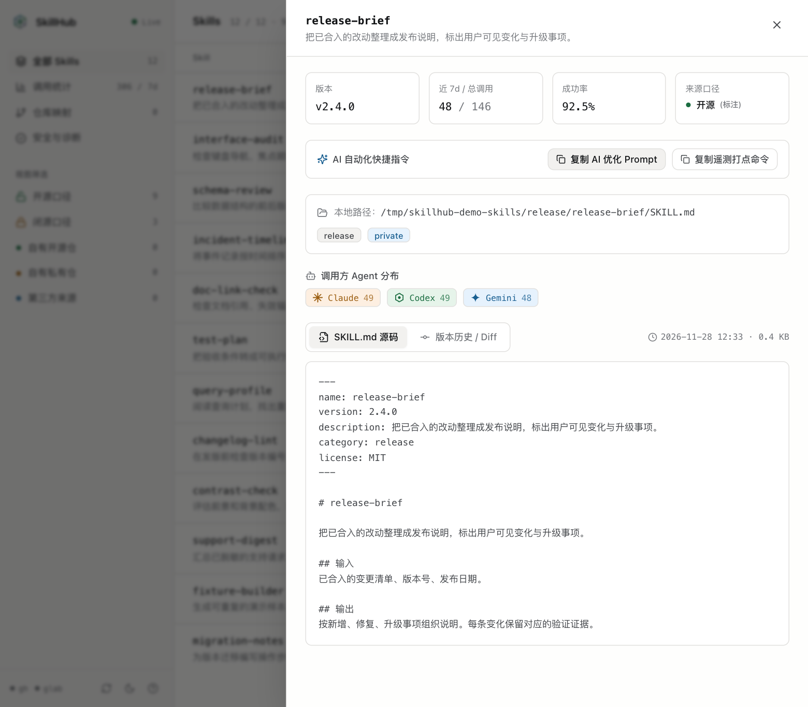

#  SkillHub

在 Claude Code、Codex 等工具里装了很多 Agent Skills？SkillHub 把它们列在一张本地清单中，让你找到每项技能的来源、版本，以及最近有没有登记过使用结果。

[从源码安装](#快速开始) · [查看技能档案](#技能档案) · [CLI 命令](#命令) · [](https://github.com/webkubor/skillhub/actions/workflows/ci.yml)



## 快速开始

准备好 Git 和 Node.js 24，或使用 CI 所测的 Node.js 22 最新补丁版。在 macOS 或 Linux 终端运行：

```bash
git clone https://github.com/webkubor/skillhub.git
cd skillhub
npm ci && npm --prefix web ci
npm run build:all
./install.sh
skillhub serve --port 4319
```

在浏览器打开 [本地控制台](http://127.0.0.1:4319)。若终端找不到 `skillhub`，可在仓库目录运行 `node dist/cli.js serve --port 4319`。

## 技能档案



- **查来源。** 查看技能来自哪个目录，核对同名项和版本，再决定维护哪一份。
- **查使用。** 用 `skillhub use` 登记任务结果，之后可按技能、Agent 或时间查看。零条记录表示还没有登记结果。
- **做清理。** 先用 `skillhub doctor` 找格式问题，用 `skillhub audit` 检查发布风险，再决定归档哪些技能。

技能正文保留在原仓库，使用记录保存在本机 SQLite。CS 用户可通过 [skillhub-ops](integrations/cs/skillhub-ops/SKILL.md) 访问同一套工具。

## 命令
| 命令 | 用途 |
|---|---|
| `scan` | Skill 清单/分类/来源，`--json` |
| `doctor` | 坏 frontmatter + 自管无版本，退出码 1 表示有问题 |
| `audit [--json]` | 上架前安全与口径冲突门禁（闭源/公开仓冲突、明文密钥、`publish: never`、缺版本号/描述），阻断返回退出码 1 |
| `use <skill> --outcome ...` | 记一次使用（success/partial/failed） |
| `status [--json]` | gh/glab CLI 登录状态（多 host） |
| `relations [--json]` | Skill ↔ GitHub/GitLab 仓库关系：git remote/frontmatter 匹配，按当前账户公开仓校准，分自有开源/自有私有/第三方/未关联 |
| `stats` / `problems` | 次数、成功率、最近使用、问题清单，`--skill` 过滤 |
| `frequency [days]` | 近 N 天使用频次与调用 agent 数，默认 7 天；`--skill` 过滤 |
| `agents` | 按 skill + agent 聚合使用次数；`--skill` 过滤 |
| `profile [<skill>]` | 每个 Skill 的合并档案：版本、生命周期、总次数、7/30 天频次、agent 分布 |
| `lifecycle <skill> <status>` | 设置生命周期 `draft\|active\|deprecated\|archived`，`--note` 写原因 |
| `visibility <skill> open\|closed` | 设置本地开源/闭源口径，`--note` 写原因；不改 GitHub/LICENSE/外部商品配置 |
| `serve` | Hono 单端口服务（托管极简侧栏 Next.js 控制台、REST API 与 `/api/events` SSE 推流） |
| `ui <tab\|focus\|search\|theme\|refresh>` | 通过 SSE 实时遥控已打开的本地网页（切页、弹抽屉、过滤、换主题、刷新） |

扫描默认覆盖源仓 + 全运行时目录（`~/.claude`、`~/.codex`、`~/.gemini`、`~/.agents`、`~/.dsh`、`~/.cursor`、`~/.config/opencode`），软链会跟随；同名按根顺序去重，独立仓优先。
`SKILLHUB_DATA_DIR` 可改 SQLite 位置；`--root` 可改扫描根（可重复）。

## 文档
- [DESIGN.md](DESIGN.md)：Bloom OKLCH 视觉体系、品牌 Logo 与组件契约。
- [ADR-001 技术决策](docs/adr-001-tech-stack.md)：为什么保持轻量栈、CS 为什么只做消费端。
- [CS 集成契约](docs/cs-integration.md)：薄消费边界与接入方式。
- [SkillPay 合同审阅](docs/skillpay-contract-notes.md)：售卖自有 SKILL 的边界、开源/闭源切换的法律含义与上架清单。
- [线上分发平台清单](docs/distribution-platforms.md)：腾讯云 SkillHub / 支付宝 SkillPay，仅登记未接入。
- [SKILL.md](SKILL.md)：给 Agent 的用法说明。
